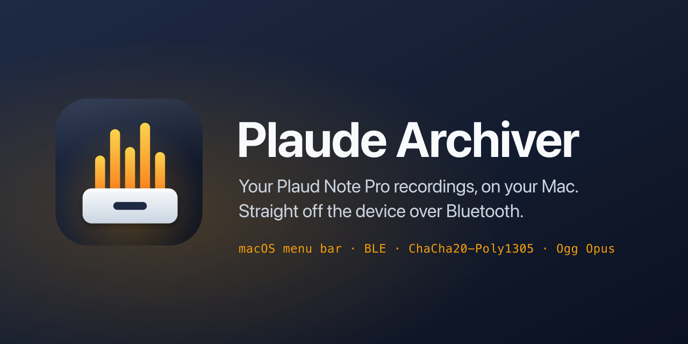
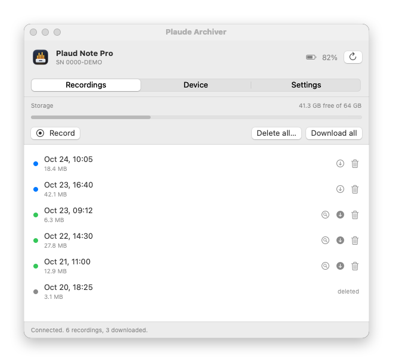
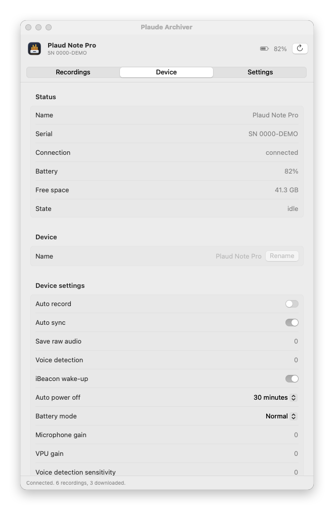
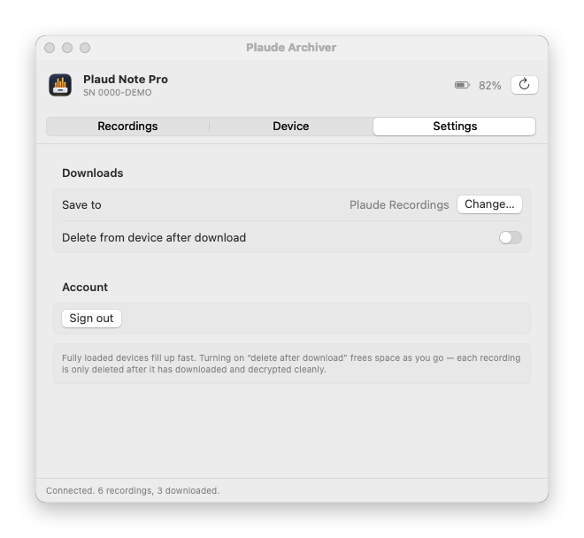

<div align="center">



<br>


**Own your recordings. Pull them off the device over Bluetooth, with no cloud sync.**

A macOS menu-bar app (and a pair of Python scripts) that talk to a **Plaud Note Pro** in its own language, decrypt its recordings, and give you plain `.ogg` files. Reverse-engineered from the Android app, down to the firmware's encrypted BLE handshake.

<sub>Plaude Archiver is an independent interoperability tool for personal use. It is not affiliated with, endorsed by, or connected to Plaud. "Plaud" and "Plaud Note Pro" are used only to describe the device it works with.</sub>

<br>

<picture>
  <source media="(prefers-color-scheme: dark)" srcset="assets/screenshots/recordings-dark.png">
  
</picture>

</div>

---

## What this is

Plaud recorders upload your audio to Plaud's cloud, where it gets transcribed and summarised. The recordings are "end-to-end encrypted", but the key comes from Plaud's own servers, so *they* can read everything. And if you only want your raw audio on your own machine, you normally have to go through their app and their cloud.

This project removes the middle step. It:

- 🔑 Logs into Plaud once (in a real browser window) to get the two keys the device needs.
- 📡 Connects to the recorder directly over **Bluetooth LE** using CoreBluetooth.
- 🔓 Runs the device's encrypted unlock handshake (RSA-wrapped **ChaCha20-Poly1305**) itself.
- 💾 Downloads every recording and decrypts each one to a playable **Ogg Opus** file.

After the one-time key fetch, it never touches Plaud's servers again.

## The menu-bar app

A waveform icon lives in your menu bar. Open it for a small dashboard:

- **Recordings**: every recording on the device with its date and size. A storage bar shows how full the device is.
  - Download, show in Finder, or delete each recording. **Download all** gets the rest, and you can cancel a download.
  - **Record**, pause, resume and stop a recording on the device. The new recording shows up in the list when you stop.
  - **Delete all** re-reads the device first. It deletes nothing if the device holds a recording you have not seen in the list, or is recording.
- **Device**: live status (serial, battery, free space, recording state, pending firmware update), rename the device, and the device's own settings. You can change auto record, auto sync, iBeacon wake-up, auto power off and battery mode. The others the device reports are shown read-only.
- **Settings**: download folder, **"delete from device after download"** to stop the device filling up, and sign out.

Downloads are built to never lose a recording:

- A broken download resumes where it stopped: after a gap, after a dropped link, or after an app restart. Progress is kept in a `.part` file next to the download.
- Every download is checked against the decrypted audio's own Ogg page checksums. The device's cipher has no integrity tag, so damaged bytes would otherwise still "decrypt".
- "Delete after download" removes the device's copy only when that check passes and the device still lists the recording at exactly the size that arrived.

The connection is built to recover by itself:

- It finds your device even when a look-alike advertises nearby: it takes the device whose serial your account has a signature for, and ignores devices that show no serial.
- The unlock takes about 1 second. A failed attempt drops the link cleanly and retries, up to 3 times. Errors that a retry cannot fix (no Bluetooth permission, Bluetooth off, device not found) stop at once with a clear message.
- If the link drops, the dashboard shows it, and the next action reconnects.
- Each time it connects, the app sets the device clock, as the Plaud app does. Recording names come from that clock.

<table>
  <tr>
    <td></td>
    <td></td>
  </tr>
  <tr>
    <td align="center"><sub>Device</sub></td>
    <td align="center"><sub>Settings</sub></td>
  </tr>
</table>

```bash
cd PlaudeArchiver
./build.sh                                                        # compiles, wraps and signs "Plaude Archiver.app"
ditto "Plaude Archiver.app" "/Applications/Plaude Archiver.app"   # optional: install it
open "/Applications/Plaude Archiver.app"
```

- **Sign in to Plaud** opens `web.plaud.ai` in a window. Log in normally. The app reads the session cookie the site sets. It never scrapes the page or asks you to paste a token.
- The first connect fetches your keys once. After that, everything happens directly over Bluetooth, and recordings save to `~/Downloads/Plaude Recordings`.

> See [DEVICE_OPERATIONS.md](DEVICE_OPERATIONS.md) for the full list of about 160 things the device protocol exposes, and a table of what a Note Pro actually answers. The Note Pro ignores some of them (the LED, bookmarks, device events), so the app does not offer those.

> macOS needs the app to be a signed bundle with a Bluetooth usage string, or it kills the process the instant it touches the radio. `build.sh` makes the bundle and ad-hoc signs it for you. Because the signature is ad hoc, macOS treats every rebuild as a new app and asks for Bluetooth permission again.

### Troubleshooting

- **The app logs every connection step** to `~/Library/Application Support/PlaudMenuBar/log.txt`. If a connect fails, the last lines say which step stopped.
- **"Could not find the device"**: wake the recorder (press its button), and make sure the Plaud phone app is not connected to it. A connected device does not advertise.
- **"Waiting for Bluetooth permission"**: click Allow in the macOS prompt, then refresh. This happens after every rebuild.

### Testing against a real device

The app has hidden headless modes for checking a device. Launch them through `open`, so that macOS gives the app its own Bluetooth permission. Run directly from a shell, the process is stopped (exit code 134).

```bash
open -n -W --stdout /tmp/out.txt --stderr /tmp/err.txt "Plaude Archiver.app" --args --probe-device
```

| Mode | What it does to the device |
|------|------|
| `--probe-device` | Reads status and lists recordings. Changes nothing. |
| `--probe-settings` | Reads every setting and every read command, and prints the raw replies. Changes nothing. |
| `--probe-features [--resume-from <plaud_ID.plaud>]` | Sets the clock, writes the name back unchanged, changes 5 settings and restores each one, and tests resume, the integrity check and cancel. With `--resume-from`, it also re-downloads that recording into your download folder. |
| `--test-recording` | Starts, pauses, resumes and stops a recording. **Leaves a short recording on the device.** |
| `--selftest` | Downloads the smallest recording, verifies it, then **deletes it from the device**. |

## The Python scripts

For the terminal crowd, same capability, fewer frameworks:

```bash
pip install bleak requests cryptography
python3 plaud_ble_pull.py --scan                       # find your device
python3 plaud_ble_pull.py --address <ADDR> --token <user_id> \
        --keys-dir ./secrets/keys                      # pull + decrypt over BLE
```

`plaud_cloud_pull.py` is the alternative path: it downloads whatever your device already synced, straight from Plaud's cloud API.

## How it works

```
  web.plaud.ai  ──login cookie──▶  sn-sign + gen_key  ──▶  device signature + your RSA key
                                                                    │
  Note Pro  ◀──BLE 0x1910──▶  FE10 signature ▶ FE12 secret ▶  RSA-unwrap ▶ ChaCha20-Poly1305 session
                                                                    │
                            handshake ▶ list ▶ pull  ──▶  PLAUD.AI file  ──▶  decrypt  ──▶  .ogg
```

The full protocol (GATT UUIDs, packet framing, the protocol-20 RSA handshake, the ECC protocol-30 variant, and the on-device file format) is written up in **[PLAUD_NOTE_PRO_PROTOCOL.md](PLAUD_NOTE_PRO_PROTOCOL.md)**.

### Architecture (Swift)

| File | Does |
|------|------|
| `LoginWindow.swift` | WKWebView + session-cookie capture |
| `PlaudAPI.swift` | `sn-sign` / `gen_key`, Fernet-decrypts replies, follows the region redirect |
| `Crypto.swift` | Fernet (AES-CBC + HMAC), RSA PKCS#1, ChaCha20, the `PLAUD.AI` file format, the Ogg integrity check |
| `Protocol.swift` | Tinnotech BLE packet format, command numbers, and the ChaCha20-Poly1305 session |
| `BLE.swift` | CoreBluetooth: device selection, connect, unlock, handshake, ordered sends, resumable pull, recording control, settings, device events |
| `DeviceModel.swift` | Dashboard state: connect with retries, download with resume and integrity checks, delete safety, recording control, device settings, polling, the test modes |
| `DashboardView.swift` | The SwiftUI dashboard |
| `AppDelegate.swift` | Menu bar wiring and the dashboard window |
| `Screenshots.swift` | Renders the README screenshots from sample data |

## What the teardown turned up

- The device's recordings are encrypted on the device, to a key only your account's RSA key can unwrap.
- But Plaud's `gen_key` endpoint gives *your private key* to the app (and keeps a copy). So the "end-to-end" encryption is **not** private from Plaud. This tool inherits that: it removes your dependence on Plaud's app, not Plaud's ability to read your audio. Re-binding the device to a key pair you generate yourself would fix that. See the protocol notes.
- The device checks a cloud-issued signature over its serial before it trusts the app. That signature is static and reusable, so once fetched, your device works offline forever.

## Status

✅ Verified end to end on a real Plaud Note Pro: login → key fetch → BLE unlock → download → decrypt → playable Opus.

✅ Also tested on the device (2026-10-24): clock sync, rename, resumed downloads (a download started halfway matched a full copy byte for byte), cancel, the integrity check, record / pause / resume / stop, and changing each editable setting and restoring it.

Not tested on a device: **Delete all**, and the two checks that refuse a delete (a recording you have not seen, a size mismatch).

## Branding

The logo is a voice waveform dropping into an archive drawer. Sources are in [`assets/`](assets):

| File | What |
|------|------|
| `icon.svg` | The app icon. The source for everything below. |
| `banner.svg` | The README header and the GitHub social preview (1280×640). |
| `build-icons.sh` | Renders `PlaudeArchiver/AppIcon.icns`, `icon-512.png` and `banner.png`. Needs `rsvg-convert`. |
| `screenshots/` | Rendered by the app from sample data, with no device or account. |

To render the screenshots again after a UI change:

```bash
cd PlaudeArchiver && ./build.sh
"./Plaude Archiver.app/Contents/MacOS/PlaudeArchiver" --screenshots ../assets/screenshots
```

Colors: ink `#0B1120` → `#1E2A44`, amber `#FCD34D` → `#F97316`, slate `#F8FAFC` → `#CBD5E1`.

## Legal & ethical

This is for pulling **your own** recordings off **your own** device. It only talks to Plaud's own servers and your hardware. It is not affiliated with, endorsed by, or supported by Plaud. Built for interoperability and research. Don't point it at devices or accounts that aren't yours.

## License

MIT.
